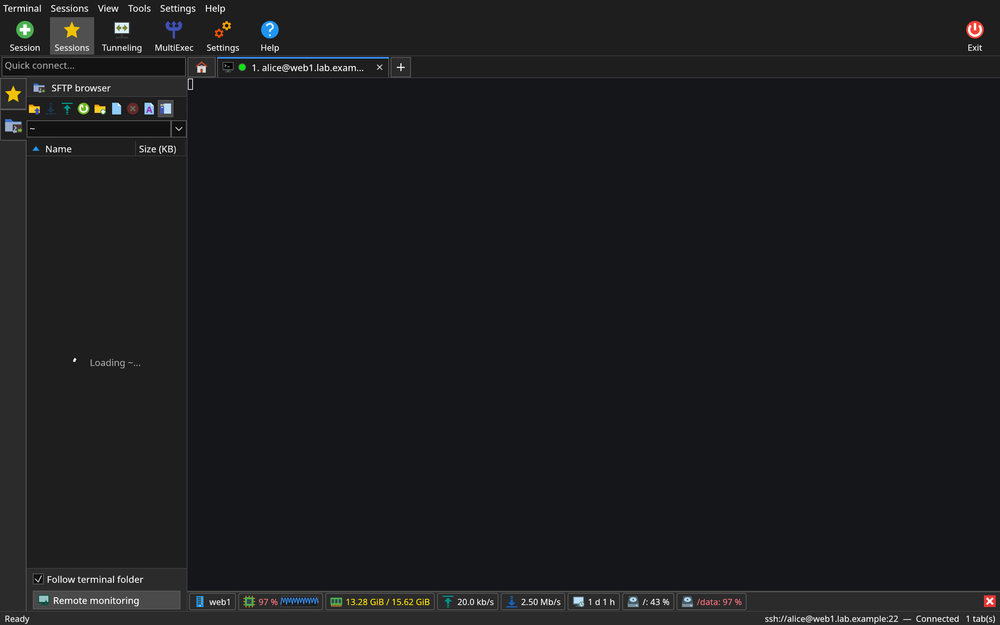
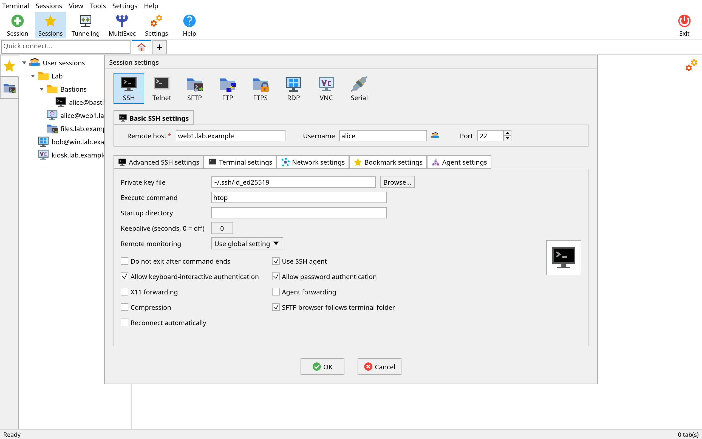
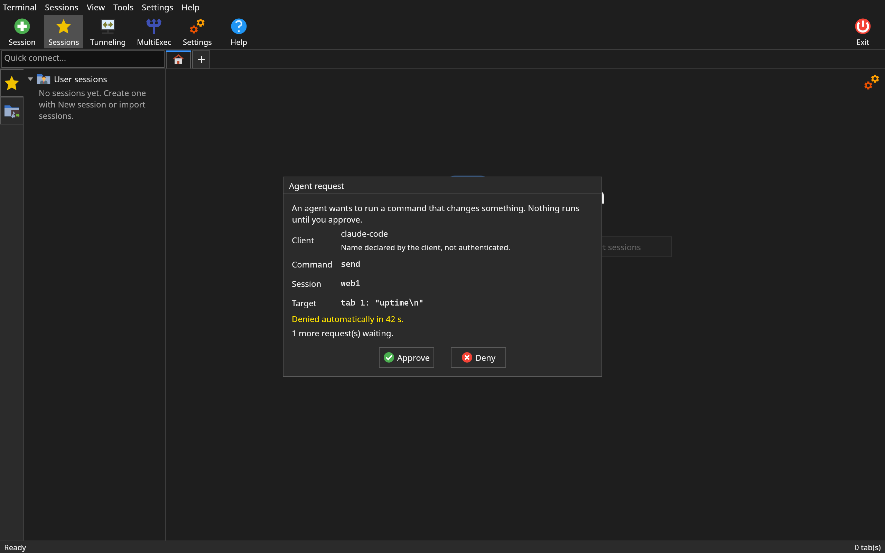

<div align="center">


# rustXterm

**Every remote session you use, in one fast native window.**

SSH, SFTP, FTP/FTPS, RDP, VNC, Telnet and Serial in tabs, with a file panel that follows your shell,
live server monitoring and an encrypted session store. Native binaries for Linux, Windows and macOS, no Electron.

[](https://github.com/jniltinho/rustXterm/releases)
[](https://github.com/jniltinho/rustXterm/releases)
[](https://github.com/jniltinho/rustXterm/actions/workflows/ci.yml)
[](LICENSE)
%20%7C%20macOS%20(preview)-lightgrey)

**[⬇ Download the latest release](https://github.com/jniltinho/rustXterm/releases/latest)**

[Install](#install) · [Quick start](#quick-start) · [Features](#features) · [CLI and MCP](#cli-and-mcp) · [Build](#build-from-source) · [Docs](#documentation)

<br>

<a href="docs/screenshots/monitor_bar_dark@2x.png"></a>

<sub>An SSH tab with the SFTP side panel and the live monitoring bar: CPU, memory, network, uptime and disks of the remote host.</sub>

</div>

## Why rustXterm

- **One app instead of five.** Terminals, file transfers and remote desktops live side by side in tabs,
  organized in a session tree with colored folders.
- **Fast and light.** Native Rust and a GPU-rendered UI: one self-contained binary. No
  Electron, no webview, no runtime to install.
- **Files without leaving the shell.** The SFTP panel opens next to every SSH tab and follows the
  directory you `cd` into. Drag and drop to upload.
- **See your server at a glance.** CPU, memory, disk, network and uptime under each SSH tab, read over
  the existing connection: nothing to install on the server.
- **Secure by default.** Sessions and passwords are encrypted at rest under a master password; host
  keys are checked on every hop; tunnels bind to `127.0.0.1` unless you say otherwise.
- **Bring your sessions.** Import from a MobaXterm.ini file in a few clicks (passwords are never
  imported).
- **Scriptable and AI-ready.** A CLI and an MCP server let you, your scripts or an AI agent open
  sessions, run commands and move files, with per-session permissions, approval prompts and an
  audit log. Off until you turn it on.

## Features

| Area | What you get |
|---|---|
| **SSH** | Password, public key, agent and keyboard-interactive auth; host keys checked before auth on every hop; jump hosts; compression; remote command; X11 forwarding (off by default) |
| **Terminal** | xterm-256color with truecolor, mouse reporting, scrollback, search, paste confirmation; MultiExec typing into selected tabs; bundled Cascadia Mono (default), JetBrains Mono, Hack, DejaVu Sans Mono, Inconsolata, IBM Plex Mono, Source Code Pro, Fira Mono, Ubuntu Mono and Terminus; bar, block or underline cursor; 13 color schemes plus [your own](docs/README.md#terminal-color-schemes-and-zoom); font zoom (Ctrl+wheel, Ctrl+= / Ctrl+- / Ctrl+0) kept across restarts |
| **Files** | SFTP side panel that follows the shell's directory, with Name, Size (KB), Last modified, Owner, Group and Access columns; dual-pane SFTP and FTP/FTPS tabs (explicit/implicit TLS, passive/active); per-tab transfer list with Open and Show in folder for downloads |
| **Local terminal** | The "+" after the last tab (or Ctrl+Shift+T) opens your own shell in your home folder with a welcome box, like MobaXterm: your login shell on Linux, PowerShell (or cmd) on Windows 10 1809 and later. Closing the tab ends the shell and what it started; agents cannot use local terminals |
| **Telnet and Serial** | Telnet sessions (raw TCP mode, optional auto-login, plaintext warning); serial consoles with port discovery and line settings |
| **Monitoring** | Agentless bar under SSH tabs with live CPU, memory, disk usage, network throughput and uptime of the remote host |
| **Remote desktop** | Native RDP (IronRDP) and VNC (vnc-rs) embedded in tabs, VNC over SSH, view-only mode, limits against hostile servers |
| **Tunnels** | Local, remote and dynamic (SOCKS5) forwarding; listeners bind `127.0.0.1` unless you confirm otherwise |
| **Encrypted store** | Sessions, credentials, trust records, audit and history in SQLCipher, unlocked by a master password and optionally the desktop keyring |
| **Import** | Import sessions from a MobaXterm.ini file (never passwords) with preview and skip report; TOML export without credentials |
| **Agent control** | `rustxterm` CLI and local MCP server: off by default, same user only, per-session policies, approvals, audit log |
| **Desktop** | Light, dark and follow-system themes on every screen; original flat icon set; notifications for background transfers and dropped sessions; session folders remember their state; window reopens on the monitor you left it on |

Status: Linux x86_64 is the primary target; Windows x86_64 and macOS (universal, Apple Silicon +
Intel) ship as previews with every release. XDMCP and rsh are planned; see the
[roadmap](docs/README.md#roadmap-and-openspec-changes).

## Screenshots

<table>
  <tr>
    <th>Tabs for SSH, SFTP and RDP (light)</th>
    <th>Dual-pane FTP/FTPS (dark)</th>
  </tr>
  <tr>
    <td><a href="docs/screenshots/main_tabs_light@2x.png"></a></td>
    <td><a href="docs/screenshots/file_tab_ftp_dark@2x.png"></a></td>
  </tr>
  <tr>
    <th>Session editor (light)</th>
    <th>Agent approval prompt (dark)</th>
  </tr>
  <tr>
    <td><a href="docs/screenshots/editor_ssh_advanced_light@2x.png"></a></td>
    <td><a href="docs/screenshots/agent_approval_dark@2x.png"></a></td>
  </tr>
</table>

Rendered offscreen by the test suite with fictional data and the project's own icon set. Every screen
in both themes is in the [screenshot gallery](docs/screenshots/README.md).

## Install

Download from [GitHub Releases](https://github.com/jniltinho/rustXterm/releases). Linux x86_64, any
glibc-based distribution with glibc 2.31 or newer (Ubuntu 20.04+, Debian 12+, Fedora, Arch).

| Asset | Use |
|---|---|
| `rustxterm-X.Y.Z-x86_64.AppImage` | Download, `chmod +x`, run |
| `rustxterm-X.Y.Z-x86_64.tar.gz` | Binary, `.desktop` file, icon, licenses |
| `rustxterm-X.Y.Z-x86_64` | Portable single binary |
| `SHA256SUMS` | Checksums for all of the above |

```sh
sha256sum --check --ignore-missing SHA256SUMS
chmod +x rustxterm-X.Y.Z-x86_64.AppImage
./rustxterm-X.Y.Z-x86_64.AppImage
```

It needs a Vulkan or OpenGL driver (Mesa is fine) and an X11 or Wayland session. On X11 (or
Xwayland) it also needs `libxkbcommon-x11`, which some Wayland-first installs omit (Ubuntu 26.04:
`sudo apt install libxkbcommon-x11-0`). FUSE 2 is not needed for the AppImage.
`rustxterm --self-test` runs headless checks. On first start it writes
`~/.local/share/applications/rustxterm.desktop` and its icon (unless a system entry exists), so
GNOME and KDE show the rustXterm icon on Wayland.

**Windows (preview, x86_64):** `rustxterm-X.Y.Z-windows-x86_64.zip` (portable `rustxterm.exe` and
`rustxterm-cli.exe`) and a per-user `rustxterm-X.Y.Z-x86_64.msi` ship with every release; they are
unsigned, so SmartScreen may ask for confirmation. The MSI installs
without administrator rights, but Windows Server 2022 disables installs by standard users by default
(`DisableMsi` policy, error 1625): install as an administrator there, or use the zip.

**macOS (preview, universal):** `rustxterm-X.Y.Z-macos-universal.dmg` (drag `rustXterm.app` to
Applications) and `rustxterm-X.Y.Z-macos-universal.tar.gz` (the app bundle and licenses) ship with
every release. The binary is universal (Apple Silicon and Intel in one download) and needs macOS 13
(Ventura) or newer. The app is ad-hoc signed (no Apple Developer ID), so Gatekeeper blocks the first
launch: right-click the app and choose **Open**, or allow it in System Settings → Privacy & Security →
Open Anyway; after that it launches normally. The Keychain holds the optional session-store key.

The renderer picks a GPU backend automatically (OpenGL on Windows when a hardware adapter exists,
since DX12 flickers on some Intel drivers). Set `WGPU_BACKEND=gl`, `vulkan` or `dx12` to force one if
the window flickers or stays black.

## Quick start

1. Start `rustxterm` and choose a master password. It encrypts all sessions and credentials and
   **cannot be recovered**. Optionally let the desktop keyring unlock it.
2. Create a session with **New session**, or type `user@host` in quick connect. The **+** after
   the last tab opens a local terminal on your own computer.
3. Check the host key fingerprint and accept it. The SFTP panel opens next to the terminal.
4. To import sessions from a MobaXterm.ini file, use **Import sessions** or
   `rustxterm import mobaxterm-ini MobaXterm.ini`.

<details>
<summary>Configuration files and environment variables</summary>

Settings live in `~/.config/rustxterm/config.toml`; data lives under `~/.local/share/rustxterm/`.
Settings can be overridden with `--env-file` or `RXT_*` variables:

| Variable | Effect |
|---|---|
| `RXT_THEME` | `light`, `dark` or `system` |
| `RXT_LOG_LEVEL` | Tracing filter, e.g. `info`, `debug` |
| `RXT_DEBUG_LOG` | Full debug log file, same as `--debug-log PATH` (below) |
| `RXT_DATA_DIR` | Data directory |
| `RXT_AGENT_CONTROL` | Agent control on or off (`true`/`false`) |

Precedence: CLI > environment / `.env` > TOML > defaults. Secret-like keys are refused.

**Debug log.** `rustxterm --debug-log` writes a full debug log (every protocol, connection steps and
errors) to `rustxterm-debug.log` in the current directory, or in the config folder when the current
directory is not writable (an app started from Finder or a Windows shortcut); `--debug-log PATH`
chooses the file. It is owner-only and never holds passwords, keys or NTLM/CredSSP messages; attach it
to a bug report.

If a graphics driver crashes while the window starts, the next launch picks a safer rendering
backend by itself (Windows: OpenGL → DirectX 12 → Vulkan → software; Linux: Vulkan → OpenGL →
software) and says so in the status bar; choose one in **Settings › Display › Graphics**, or start
once with `rustxterm --safe-gpu` for software rendering.

</details>

## CLI and MCP

The same binary is a CLI. Reads of saved data work offline; commands on open tabs talk to the running
instance once you enable **Settings → Agent control**.

```sh
rustxterm sessions list --json
rustxterm open prod-web                 # open a saved session in the running GUI
rustxterm send 3 'uptime' --enter
rustxterm wait 3 'load average' --timeout 10s
rustxterm read 3 --lines 20
rustxterm files get 3 /var/log/syslog syslog.txt
rustxterm tunnel start db-forward
```

MCP clients start `rustxterm mcp` over stdio:

```json
{ "mcpServers": { "rustxterm": { "command": "rustxterm", "args": ["mcp"] } } }
```

New sessions default to the `deny` agent policy; `ask` shows an approval prompt in the GUI. Adding,
editing or removing sessions, trust decisions, credentials and policies are never available to agents.

<details>
<summary>MCP tools</summary>

17 tools while the GUI runs, including `list_sessions`, `open_session`, `read_terminal`, `send_input`,
`wait_for_output`, `screenshot_tab`, `file_get`, `file_put` and `tunnel_start`; 5 read-only tools work
offline. See [agent control](docs/README.md#agent-control-cli-and-mcp) in the documentation index.

</details>

<details>
<summary>Exit codes</summary>

| Code | Meaning |
|---|---|
| 0 | Success |
| 1 | Failed |
| 2 | Usage error |
| 3 | Store locked |
| 4 | Denied by policy or approval |
| 5 | rustXterm is not running |
| 6 | Agent control is off |

</details>

## Architecture

<p align="center">
  
</p>

One crate per protocol, a `platform` contract crate with Linux, Windows and macOS adapters, an engine where every UI action
is a command, and a thin egui UI with theme tokens; `cargo xtask layers` enforces the layers. The other
seven diagrams (data flow, SSH sequence, encrypted store, agent control, release pipeline, test lab,
roadmap) are in the [documentation index](docs/README.md).

## Build from source

Builds, lints and tests run only in Docker; the host needs only Docker, git and optionally `make`.
The root `Makefile` wraps the Docker workflow (`make help` lists every target):

```sh
make build                      # debug build of the workspace
make check                      # fmt-check, clippy, tests, layers, scenarios
make guard                      # publication guard, run before every push
make lab-up lab-test lab-down   # integration tests against the disposable protocol lab
make dist VERSION=0.0.0-test    # binary, AppImage, tarball and SHA256SUMS in dist/
```

Without `make`, call the wrapper directly: `scripts/cargo-docker.sh cargo test --workspace`. The
[developer guide](docs/DEVELOPMENT.md) covers the full workflow.

The toolchain stages (pinned Rust, mingw-w64 for Windows, AppImage tools) are also published on Docker
Hub as `jniltinho/rustxterm-{toolchain,windows-toolchain,appimage-tools}:snapshot-20261001`; CI uses
them as build cache, and the `Dockerfile` remains the source of truth.

## Documentation

| Document | Contents |
|---|---|
| [Developer guide](docs/DEVELOPMENT.md) | Prerequisites, Docker workflow, tests, lab, coding rules |
| [Documentation index](docs/README.md) | Architecture, data flow, store, agent control, diagrams, roadmap |
| [Screenshot gallery](docs/screenshots/README.md) | Every screen in light and dark themes |
| [Releases](docs/release.md) | Cutting and verifying a release |
| [Protocol lab](lab/README.md) | Docker lab services and fictional credentials |

## Security

- All stored data is encrypted at rest (SQLCipher, AES-256); the database key is wrapped with Argon2id and
  XChaCha20-Poly1305 by your master password and, optionally, the desktop keyring (Secret Service).
- Host keys are checked before authentication on every hop; changed or revoked keys are refused, and an
  unreadable trust source fails closed. FTPS and RDP certificates are pinned on first use.
- Agent control is off by default, reachable only by your user (a Unix socket on Linux, a named pipe
  with an owner-only ACL and an elevation check on Windows), and never discloses
  passwords or keys: credentials appear only as `saved` or `absent`.
- Remote desktop clients cap framebuffer size and memory and time out stalled servers.
- Releases are built in a pinned, offline Docker build and published with `SHA256SUMS`.

## Contributing and feedback

Bug reports, ideas and pull requests are welcome: open an
[issue](https://github.com/jniltinho/rustXterm/issues). The [developer guide](docs/DEVELOPMENT.md)
explains the Docker-only workflow and the test lab. If rustXterm is useful to you, a ⭐ helps other
people find it.

## License

rustXterm is released under the [MIT License](LICENSE).

Every icon, image, font and fixture is listed with its origin and license in
[ATTRIBUTION.md](ATTRIBUTION.md). The application icon set in `assets/icons/app/` is original and MIT
licensed; the distribution logos in `assets/icons/app/brands/` are trademarks of their owners.

<details>
<summary>Acknowledgements</summary>

rustXterm stands on great open-source work, including
[egui/eframe](https://github.com/emilk/egui), [alacritty_terminal](https://github.com/alacritty/alacritty),
[russh](https://github.com/Eugeny/russh), [suppaftp](https://github.com/veeso/suppaftp),
[IronRDP](https://github.com/Devolutions/IronRDP), [vnc-rs](https://github.com/HsuJv/vnc-rs),
[rusqlite](https://github.com/rusqlite/rusqlite) with [SQLCipher](https://www.zetetic.net/sqlcipher/),
[oo7](https://github.com/bilelmoussaoui/oo7), the [RustCrypto](https://github.com/RustCrypto) crates,
[rmcp](https://github.com/modelcontextprotocol/rust-sdk), [clap](https://github.com/clap-rs/clap),
[rpassword](https://github.com/conradkleinespel/rpassword),
[cargo-zigbuild](https://github.com/rust-cross/cargo-zigbuild),
[simple-icons](https://simpleicons.org/) for distribution logos, Tux by Larry Ewing, and the
[Noto Sans](https://notofonts.github.io/), [Cascadia Mono](https://github.com/microsoft/cascadia-code),
[JetBrains Mono](https://www.jetbrains.com/lp/mono/), [Hack](https://sourcefoundry.org/hack/),
[DejaVu Sans Mono](https://dejavu-fonts.github.io/), [Inconsolata](https://github.com/googlefonts/Inconsolata),
[IBM Plex Mono](https://github.com/IBM/plex), [Source Code Pro](https://github.com/adobe-fonts/source-code-pro), [Fira Mono](https://github.com/mozilla/Fira),
[Ubuntu Mono](https://design.ubuntu.com/font) and [Terminus](https://files.ax86.net/terminus-ttf/) fonts.

</details>
