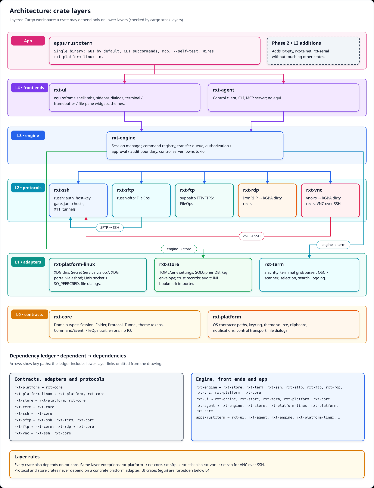
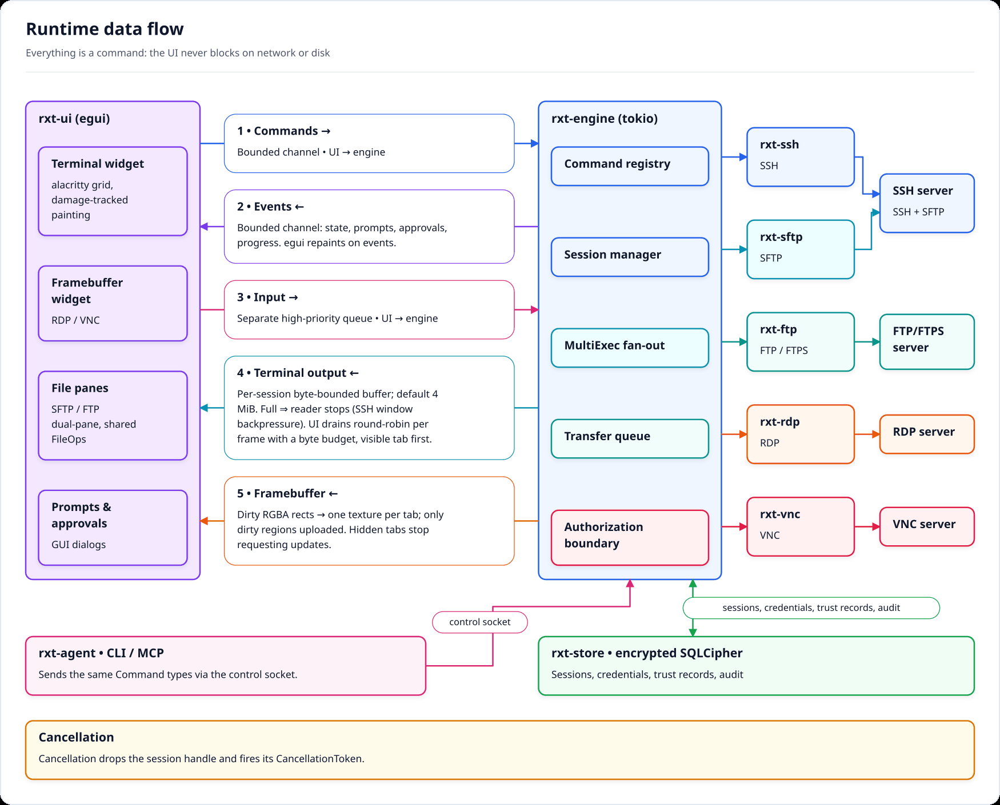
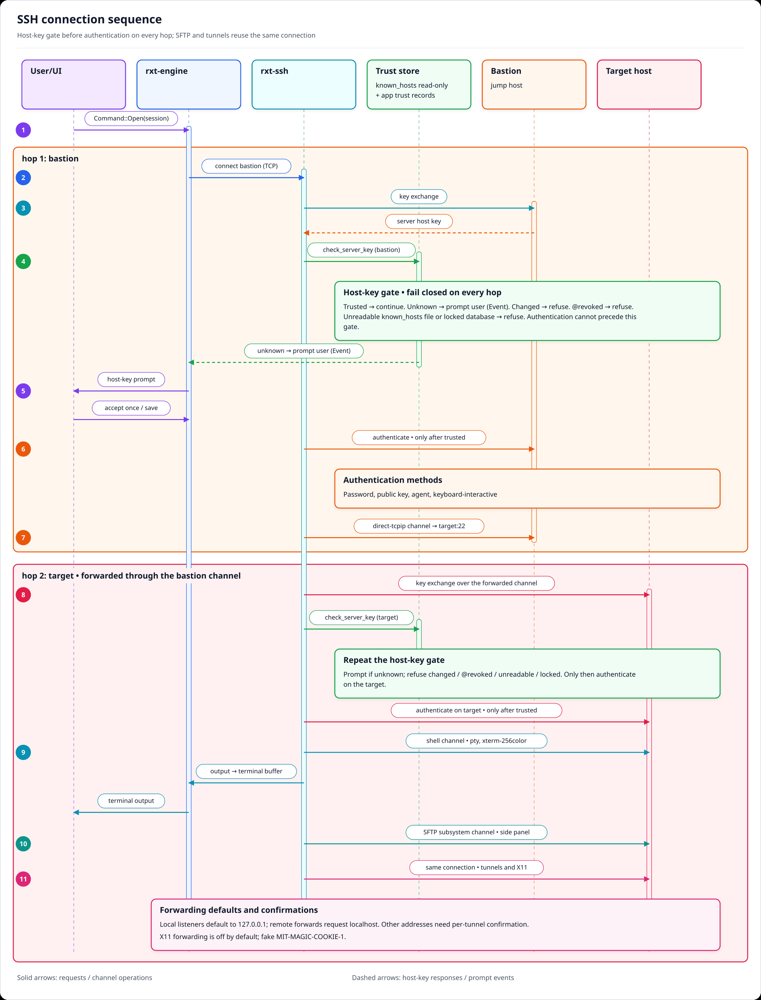
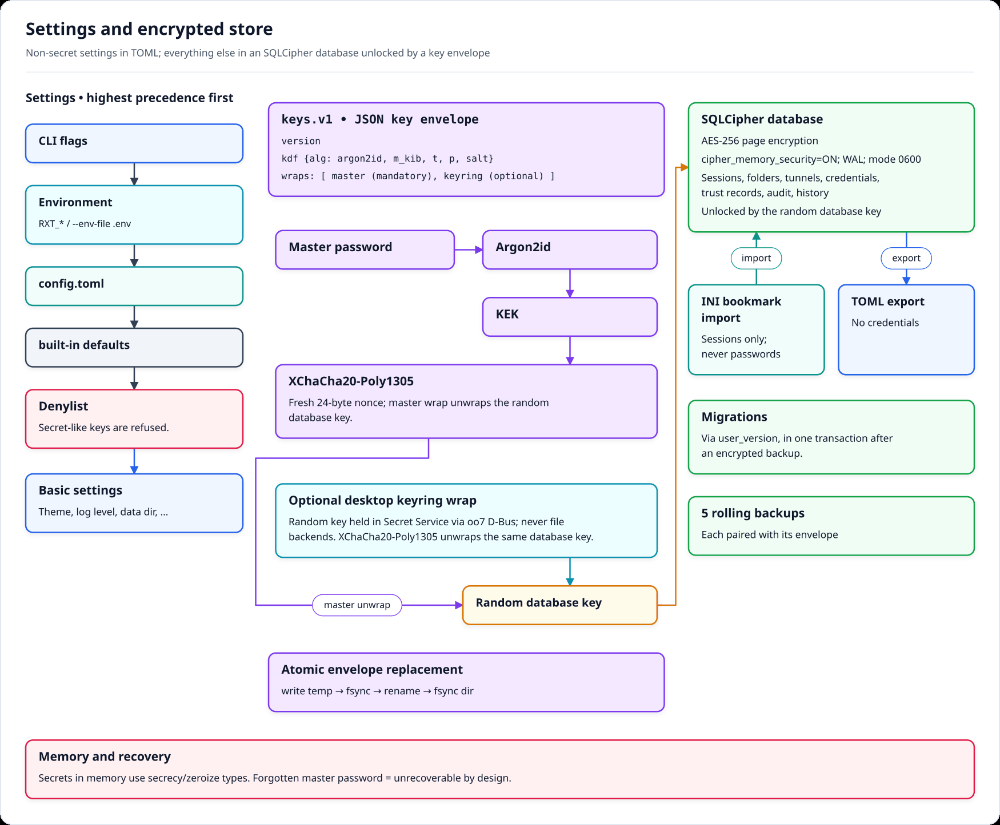
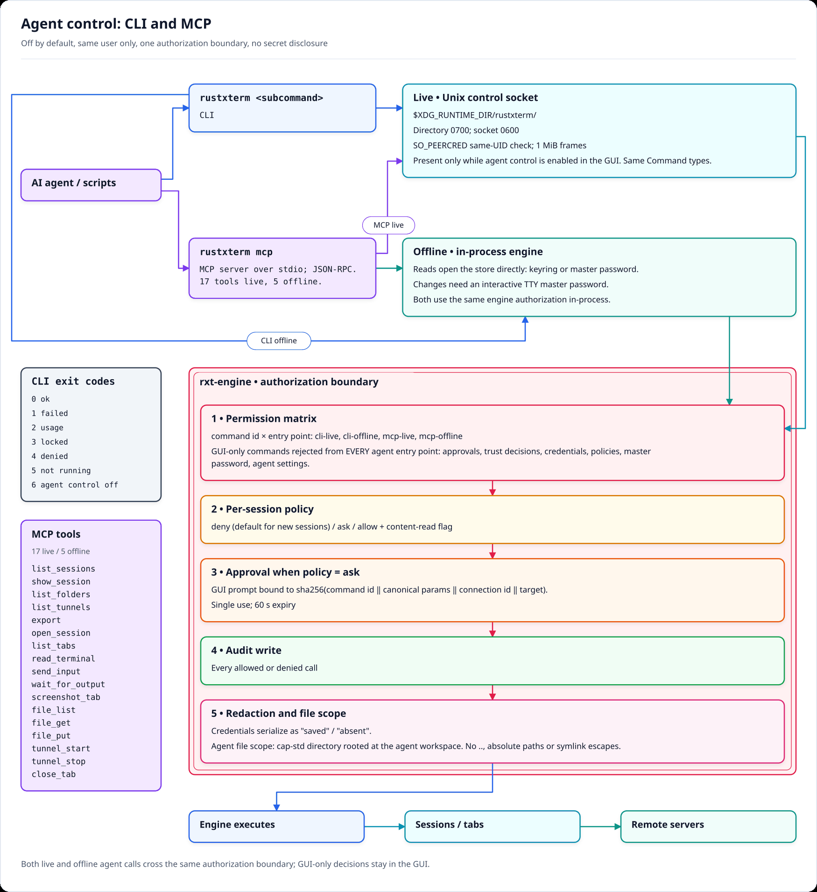
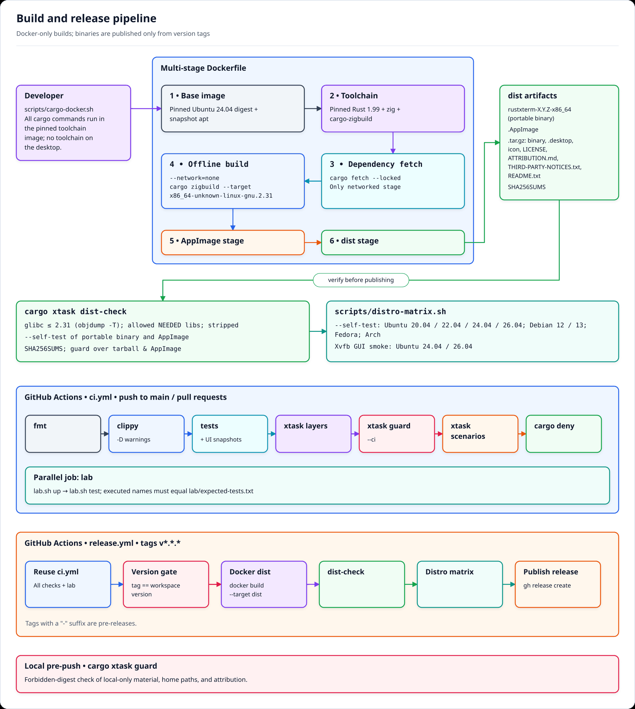
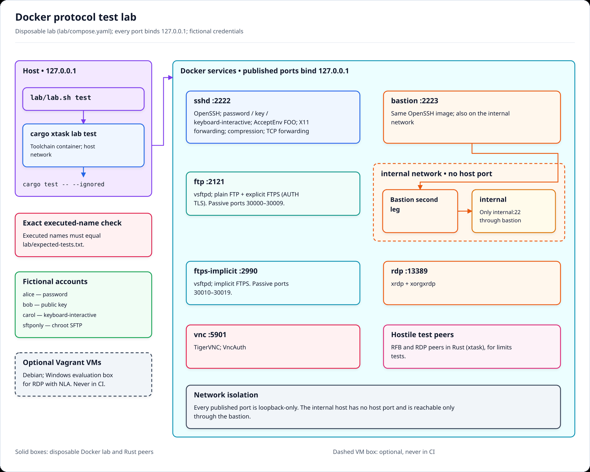
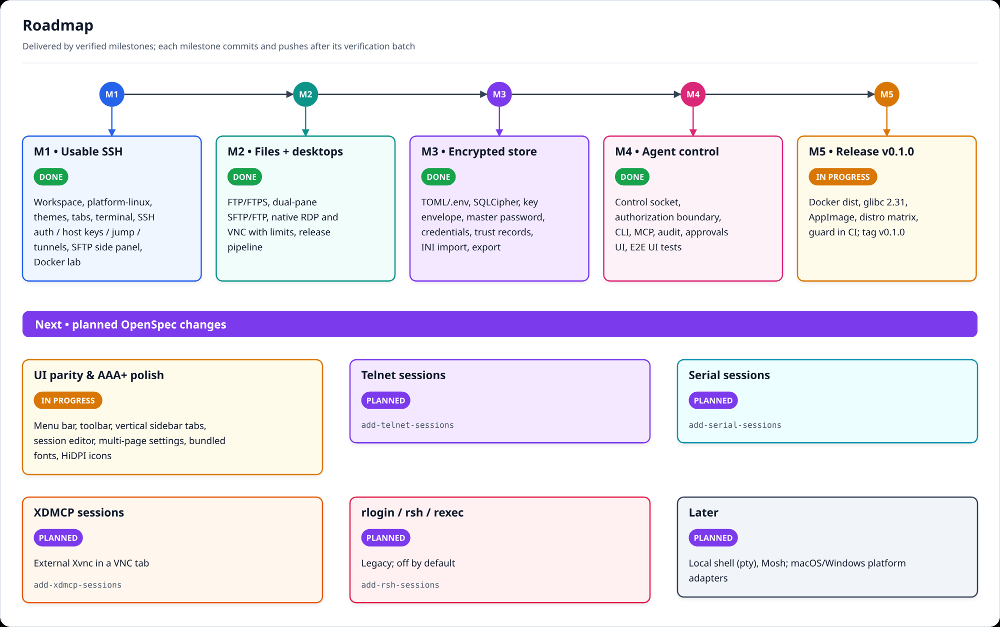

# rustXterm documentation

Index of the project documentation. Start with the [root README](../README.md) for features, install and
quick start, and the [developer guide](DEVELOPMENT.md) to build, test and contribute. Design decisions and
requirements live in OpenSpec under [`openspec/`](../openspec/).

- [Developer guide](DEVELOPMENT.md)
- [Architecture](#architecture)
- [Runtime data flow](#runtime-data-flow)
- [SSH connections](#ssh-connections)
- [Settings and encrypted store](#settings-and-encrypted-store)
- [Agent control (CLI and MCP)](#agent-control-cli-and-mcp)
- [Local terminal](#local-terminal)
- [Terminal color schemes and zoom](#terminal-color-schemes-and-zoom)
- [Build, release and CI](#build-release-and-ci)
- [Protocol test lab](#protocol-test-lab)
- [Gate receipts](#gate-receipts)
- [Roadmap and OpenSpec changes](#roadmap-and-openspec-changes)
- [Screenshots](#screenshots)
- [Diagrams](#diagrams)

## Local terminal

The tab strip "+" (default shortcut Ctrl+Shift+T) opens a shell on this computer
([local-shell spec](../openspec/changes/add-local-shell/)). It is never saved, exported or added to
recents, and it never writes a log file (use **Save terminal text**).

| | Linux | Windows (10 1809 or later) |
|---|---|---|
| Shell | `$SHELL` if executable, else the passwd login shell, else `/bin/sh`; started as a login shell | `pwsh.exe` on `PATH`, else Windows PowerShell, else `%ComSpec%` |
| Folder | `$HOME`, else `/` | `%USERPROFILE%`, else `%SystemDrive%\` |
| Environment | yours, plus `TERM=xterm-256color` and `COLORTERM=truecolor`; AppImage runtime variables removed | yours, plus `TERM` and `COLORTERM`; no console window |
| Closing the tab | SIGHUP, then SIGKILL after 1 s, to every process group of the shell's session | the shell runs in a kill-on-close job object: the whole tree ends, also when the app is killed |

On Linux, a process that leaves the shell's session on purpose (`setsid`, daemons) keeps running, as
with any terminal emulator. Without a pseudo-console (macOS for now, older Windows) "+" opens New
session. Agents (CLI and MCP) see local tabs in `tabs list` but every other request on them is
denied and audited, and MultiExec input from agents skips them.

## Terminal color schemes and zoom

**Settings › Terminal › Color scheme** sets the global scheme; the session editor can override it per
session (or force **Follow UI theme**). Built in: rustxterm-light, rustxterm-dark, Solarized Dark,
Solarized Light, Dracula, Gruvbox Dark, Gruvbox Light, Nord, One Dark, Monokai, Tango Dark, Tango Light
and xterm ([spec change](../openspec/changes/add-terminal-color-schemes/)).

Custom schemes go in a `schemes/` folder next to `config.toml` (`~/.config/rustxterm/schemes/` on
Linux, `%APPDATA%\rustxterm\schemes\` on Windows), one JSON file per scheme, loaded at start. Colors
are `[r, g, b, a]`; `ansi` holds the 8 normal then the 8 bright colors:

```json
{
  "name": "My scheme",
  "foreground": [220, 220, 220, 255],
  "background": [30, 30, 30, 255],
  "cursor": [220, 220, 220, 255],
  "selection": [60, 80, 110, 255],
  "ansi": [[0,0,0,255], [205,49,49,255], [13,188,121,255], [229,229,16,255],
           [36,114,200,255], [188,63,188,255], [17,168,205,255], [229,229,229,255],
           [102,102,102,255], [241,76,76,255], [35,209,139,255], [245,245,67,255],
           [59,142,234,255], [214,112,214,255], [41,184,219,255], [255,255,255,255]]
}
```

Files over 64 KiB, invalid files and names already in use (built-in names, or an earlier file in name
order) are skipped with a warning in the log.

Font zoom: Ctrl+wheel or Ctrl+= / Ctrl++ grow the font by one point, Ctrl+wheel down or Ctrl+- shrink
it, Ctrl+0 resets it (6 to 48 points). The size is saved to the global settings, or to the session
when it has its own font size, and applies to every open tab using it. Ctrl+_ and Ctrl+/ still send
0x1f to the shell.

## Architecture

rustXterm is a layered Cargo workspace (design D1). A crate may depend only on crates in lower layers;
`cargo xtask layers` enforces the table in CI.

| Layer | Crates | Role |
|---|---|---|
| L0 | `rxt-core`, `rxt-platform` | Domain types (sessions, commands/events, theme tokens, `FileOps`) and OS contracts (paths, keyring, theme source, clipboard, control transport). No IO. |
| L1 | `rxt-platform-linux`, `rxt-store`, `rxt-term` | Linux adapter (XDG, Secret Service, portal, Unix socket), settings + encrypted store, terminal model on `alacritty_terminal`. |
| L2 | `rxt-ssh`, `rxt-sftp`, `rxt-ftp`, `rxt-rdp`, `rxt-vnc` | One crate per protocol; usable and testable without a UI. |
| L3 | `rxt-engine` | Session manager, command registry, transfer queue, authorization/approval/audit boundary, control server; owns tokio. |
| L4 | `rxt-ui`, `rxt-agent` | egui/eframe shell; CLI and MCP server (no egui). |
| app | `apps/rustxterm` | Single binary: GUI, CLI subcommands, `mcp`, `--self-test`; wires `rxt-platform-linux` in. |

Protocol and store crates never depend on a concrete platform adapter, so macOS and Windows adapters can
be added later without touching protocol or UI code.



## Runtime data flow

Everything is a command (design D6): the UI sends `Command`s through a bounded channel and the engine
answers with `Event`s (state changes, prompts, approvals, progress). Terminal output is not an event:
each session has a byte-bounded buffer (4 MiB by default) that applies SSH window backpressure when full,
and the UI drains sessions round-robin with a per-frame byte budget. RDP and VNC write dirty RGBA
rectangles into one framebuffer per tab; hidden tabs stop requesting updates. The CLI and MCP server
reuse the same command types.



## SSH connections

`check_server_key` is the only host-key gate, and authentication starts only after it returns trusted,
on every hop of a jump-host chain. Trust comes from `~/.ssh/known_hosts` (read only) and the app's trust
records; unknown keys prompt, changed or revoked keys are refused, and an unreadable source fails closed.
SFTP, tunnels and X11 (off by default) use channels of the same connection. Tunnel listeners default to
`127.0.0.1`.



## Settings and encrypted store

Non-secret settings come from `config.toml`, an explicit `--env-file` and `RXT_*` variables (precedence:
CLI > environment/.env > TOML > defaults; secret-like keys are refused). Sessions, folders, tunnels,
credentials, trust records, audit and history live in an SQLCipher database whose key is wrapped in the
`keys.v1` envelope: Argon2id + XChaCha20-Poly1305 with a mandatory master-password wrap and an optional
desktop-keyring wrap (design D8). Five rolling encrypted backups are kept, each paired with its envelope.
A forgotten master password is unrecoverable by design.



## Agent control (CLI and MCP)

AI agents and scripts drive rustXterm through the `rustxterm` CLI or the stdio MCP server
(`rustxterm mcp`). Live commands go over a same-user Unix socket (`$XDG_RUNTIME_DIR/rustxterm/`,
`SO_PEERCRED`) that exists only while agent control is enabled. Every call crosses one authorization
boundary in the engine: permission matrix per entry point, per-session policy (`deny` by default,
`ask`, `allow`), single-use approvals bound to the exact request, and an audit record. Application-held
secrets are never disclosed (design D14). See the [M4 gate receipt](gates/m4.md) for the evidence.



## Build, release and CI

Builds, lints and tests run only in Docker (`scripts/cargo-docker.sh`). The release binary is built with
`cargo zigbuild` against glibc 2.31 and shipped as a portable binary, an AppImage and a tarball with
`SHA256SUMS`. `ci.yml` runs the checks and the lab on `main` and pull requests; `release.yml` is the only
workflow that builds and publishes binaries, on `v*.*.*` tags.

- [Developer guide](DEVELOPMENT.md)
- [Cutting a release](release.md)



## Protocol test lab

A disposable Docker Compose lab (sshd, bastion + internal host, vsftpd with FTP/FTPS, xrdp, TigerVNC)
binds every port to `127.0.0.1` and uses fictional credentials. Lab tests are `#[ignore]`d and run with
`lab/lab.sh test`; the executed test names must equal `lab/expected-tests.txt`.

- [Lab README](../lab/README.md)



## Gate receipts

Each milestone ends with a verification batch; its receipt records commands and results.

- [M1: usable SSH](gates/m1.md)
- [M2: files and remote desktops](gates/m2.md)
- [M4: agent control](gates/m4.md)
- [Release v0.1.0: distribution matrix, CI, acceptance, scenario map](gates/release.md)

## Roadmap and OpenSpec changes



| Change | Scope | Status |
|---|---|---|
| [`create-native-rust-linux-terminal`](../openspec/changes/archive/2026-10-14-create-native-rust-linux-terminal/) | v0.1: SSH, SFTP, FTP/FTPS, RDP, VNC, encrypted store, agent control, distribution | Done and archived (v0.1.0–v0.2.1; desktop acceptance v0.2.1) |
| [`refine-ui-layout`](../openspec/changes/refine-ui-layout/) | Visual and interaction refinement of the UI (menu bar, sidebar, editor, settings, fonts, HiDPI icons) | Done (68/71 review rows; tunnel diagram editor and SFTP toolbar overflow deferred) |
| [`add-telnet-sessions`](../openspec/changes/add-telnet-sessions/) | Telnet terminal sessions | Planned |
| [`add-serial-sessions`](../openspec/changes/add-serial-sessions/) | Serial console sessions | Planned |
| [`add-xdmcp-sessions`](../openspec/changes/add-xdmcp-sessions/) | XDMCP through an external `Xvnc` shown in a VNC tab | Planned |
| [`add-rsh-sessions`](../openspec/changes/add-rsh-sessions/) | rlogin / rsh / rexec, legacy and off by default | Planned |

## Screenshots

Renders of rustXterm's own UI, generated offscreen by the test suite in light and dark themes, are in
the [screenshot gallery](screenshots/README.md), grouped by screen.

## Diagrams

All diagrams are in [`diagrams/`](diagrams/) as SVG (source) and PNG. They were generated by the
rustXterm developers with the Codex CLI from the design documents and are MIT licensed
(see [ATTRIBUTION.md](../ATTRIBUTION.md)).

| File | Shows |
|---|---|
| `01-architecture-layers` | Crate layers L0–L4 and the allowed dependency directions |
| `02-runtime-dataflow` | Commands, events, byte-bounded output buffers and framebuffers between UI, engine and protocols |
| `03-ssh-connection-sequence` | Host-key gate and authentication on every hop, jump host, SFTP and tunnels on one connection |
| `04-encrypted-store` | Settings precedence, `keys.v1` envelope, SQLCipher database and backups |
| `05-agent-control` | CLI/MCP, control socket, authorization boundary, exit codes and MCP tools |
| `06-build-release` | Docker toolchain, glibc 2.31 build, dist artifacts and the GitHub Actions workflows |
| `07-test-lab` | Docker lab services, ports and networks |
| `08-roadmap` | Milestones and planned changes |
