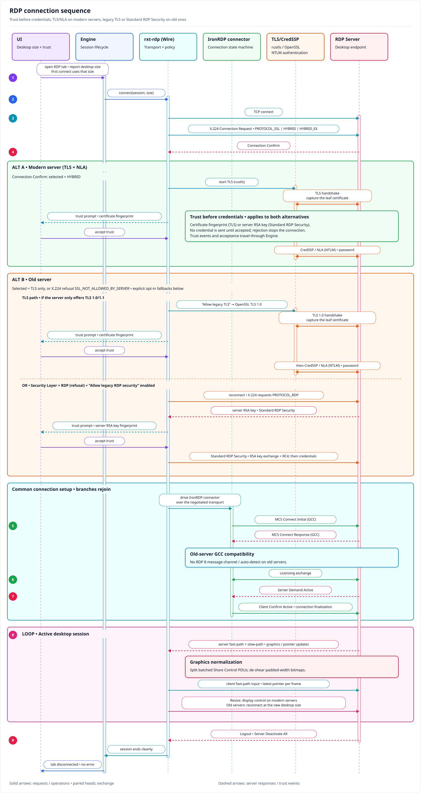

# Connecting to Windows with RDP

rustXterm has its own RDP client (Linux and Windows); no `mstsc`, FreeRDP or other external program
is used. This guide covers the session options, the security layers Windows servers use, the trust
prompts and the errors you can meet, with the fix for each.



## Quick start

1. **New session → RDP**, enter the host, port (default 3389) and user name. The user name accepts the
   same forms as `mstsc`:
   - `administrator` (with the domain, if any, in the RDP options' **Domain** field);
   - `TRD-APP01\administrator` or `CORP\alice`: the part before `\` is used as the domain when the
     **Domain** field is empty (a local account of server `TRD-APP01`, or domain `CORP`);
   - `.\administrator`: a local account of the server you connect to;
   - `alice@corp.example` (UPN), sent as typed.
2. Connect. The first time, rustXterm shows the server's certificate (or key) fingerprint: compare it
   with the one your administrator gives you, then **Accept** (this time) or **Accept and save**.
3. Enter the password. It is asked only after the server identity is trusted.

## Session options

| Option | Default | What it does |
|---|---|---|
| Domain | empty | Domain of the account (`LAB`, `corp.example`). |
| Resolution | Fit to tab | Follows the tab size and resizes the remote desktop when the server supports it; or a fixed size. |
| Keyboard layout | Server default | Layout sent to the server (e.g. US 0x0409, Brazilian ABNT2 0x0416). |
| Share clipboard text | On | Copy and paste text between the local desktop and the remote one. |
| Allow legacy TLS 1.0/1.1 | Off | For old servers (Windows Server 2008/2008 R2 without updates) that only speak TLS 1.0/1.1. Less secure. |
| Allow legacy RDP security (no TLS, insecure) | Off | For servers whose Security Layer is **RDP** (see below). Insecure; use only when the server cannot be changed. |

## Security layers

The Windows setting **Remote Desktop Session Host → Security → "Require use of specific security layer
for remote (RDP) connections"** (registry `SecurityLayer` under
`HKLM\SYSTEM\CurrentControlSet\Control\Terminal Server\WinStations\RDP-Tcp`) decides how the connection
is protected:

| Server Security Layer | What rustXterm uses | Option needed |
|---|---|---|
| Negotiate (`1`, Windows default) | TLS + NLA (CredSSP), or TLS only when NLA is off | none |
| SSL (`2`) | TLS (+ NLA when "Require user authentication… (NLA)" is on) | none |
| RDP (`0`) | Standard RDP Security: RC4 encryption, **no TLS, no NLA** | **Allow legacy RDP security** |

### Legacy RDP security (Security Layer = RDP)

With the server set to **RDP**, a client that asks for TLS is refused. Without the option you get:

> the server only allows the legacy Standard RDP Security layer (no TLS/NLA). Enable 'Allow legacy RDP
> security' in the session's RDP settings to connect (insecure), or set the server's Remote Desktop
> "Security Layer" to Negotiate or SSL …

You have two ways out:

1. **Preferred: change the server** to Negotiate or SSL (below). Nothing changes on the client.
2. **No server change possible:** edit the session, tick **Allow legacy RDP security (no TLS,
   insecure)** and connect again. rustXterm first tries TLS as usual; only when the server answers that
   it allows nothing but the legacy layer does it reconnect with it.

What to know before ticking it:

- **The server cannot be authenticated.** The legacy layer has no certificate a client can verify (the
  server's key is signed with a key Microsoft published), so anyone on the network path could pose as
  the server. rustXterm shows the server's RSA key fingerprint the first time (the prompt reads
  *"Legacy RDP security (no TLS): this connection is not protected against interception"*, the
  fingerprint starts with `RSA `) and, if you save it, refuses the connection when the key later
  changes. Compare the fingerprint over a trusted channel before saving it.
- **The encryption is weak** (RC4, keys of 40, 56 or 128 bits chosen by the server). Treat the session
  as readable by someone who can capture the traffic.
- **No NLA:** the password is sent inside the encrypted Client Info PDU (auto-logon); Windows checks it
  only after the session has started.
- **Downgrade guard:** if you once connected to the same host name and port over TLS and saved its
  certificate, rustXterm does not fall back to the legacy layer for it, because the "TLS refused" answer
  is not authenticated and an attacker could forge it. If the administrator really switched the server
  to RDP, connect with another name for it (for example its IP address); trust is saved per host name
  and port.
- **Not supported:** servers whose encryption level is **None** (the password would travel in clear) or
  **FIPS Compliant** (3DES); both stop with an error that names the level. Server redirection (RD
  Connection Broker) is not supported in this mode.

### Changing the server to Negotiate or SSL

Group Policy (domain or `gpedit.msc`): *Computer Configuration → Administrative Templates → Windows
Components → Remote Desktop Services → Remote Desktop Session Host → Security →* **Require use of
specific security layer for remote (RDP) connections** = **Negotiate** (or **SSL**). Keep **Require user
authentication for remote connections by using Network Level Authentication** enabled.

Without Group Policy, in an elevated PowerShell on the server:

```powershell
$k = 'HKLM:\SYSTEM\CurrentControlSet\Control\Terminal Server\WinStations\RDP-Tcp'
Set-ItemProperty $k SecurityLayer 1        # 1 = Negotiate, 2 = SSL
Set-ItemProperty $k UserAuthentication 1   # NLA
```

New connections use the new setting at once; no restart is needed. A Group Policy value overrides
the registry value.

## Old servers (Windows Server 2008 / 2008 R2)

These servers predate RDP 8 and typically speak only **TLS 1.0**. Two things are needed:

- **Tick "Allow legacy TLS 1.0/1.1"** in the session's RDP options. Without it the default TLS stack
  offers only TLS 1.2/1.3, the old server resets the socket, and you get
  `Connection reset by peer (os error 104)`.
- With that option on, rustXterm also adapts to these servers automatically (no extra setting): it
  stops advertising RDP 8 features (the MCS message channel and the network-auto-detect /
  skip-channel-join capabilities), which otherwise make a 2008-era server reset the connection right
  after the login; and it accepts screen and pointer updates that such servers batch together in one
  message, which otherwise ended the session with a "decode error"; and it renders bitmaps whose width the server padded to a multiple of 4 without shearing the image.

The login then works with full NLA/CredSSP. Use the domain forms from Quick start (for example
`criarenet.net\administrator`, or `.\administrator` for a local account).

Prefer enabling TLS 1.2 on the server when you can; the legacy option is a client-side workaround, not
a fix for the server.

## Certificates and trust

- TLS servers present a certificate; Windows uses a self-signed one by default. The prompt shows its
  SHA-256 fingerprint. **Accept and save** stores it per host name and port.
- A saved certificate (or legacy key) that changes stops the connection before any credential is sent
  and shows both fingerprints. This happens after a server reinstall or certificate renewal, and also
  when someone intercepts the connection.

## Errors and fixes

| Message (start) | Cause | Fix |
|---|---|---|
| `the server only allows the legacy Standard RDP Security layer` | Server Security Layer = RDP | Change the server to Negotiate/SSL, or tick **Allow legacy RDP security** |
| `the server refused TLS, but this host was trusted over TLS before` | Downgrade guard (see above) | Check with the administrator; connect by another host name if the change is real |
| `the server offers no encryption (level None)` | Encryption level None | Set the server's encryption level to Client Compatible or High |
| `the server requires FIPS encryption` | Encryption level FIPS Compliant | Use Negotiate/SSL on the server (TLS works with FIPS) |
| `The server only offers legacy TLS (TLS 1.0/1.1 …)` | Old, unpatched server | Update the server, or tick **Allow legacy TLS 1.0/1.1** |
| `Connection reset by peer (os error 104)` | Old server (2008/2008 R2): only TLS 1.0, or RDP 8 features it does not understand | Tick **Allow legacy TLS 1.0/1.1** (see "Old servers" above) |
| `authentication failed: CredSSP: … STATUS_LOGON_FAILURE` | Wrong user, domain or password (NLA) | Check the credentials and the domain field |
| `certificate of HOST:PORT changed` | The saved certificate differs | Confirm the new fingerprint with the administrator |
| `HOST:PORT: connect timed out` | Port 3389 blocked, RDP disabled or wrong host | Check the firewall and "Allow remote connections to this computer" |

## Testing it yourself

The repository's Windows Server 2022 test VM (`lab/vagrant/windows`) can be switched between the
layers to try each case; the recipe is in [`lab/vagrant/README.md`](../lab/vagrant/README.md) and the
last results are in [`docs/gates/rdp-standard-security.md`](gates/rdp-standard-security.md).

To check a real host before connecting, `scripts/rdp-probe.py <host>` reports its security layer
without sending any credentials (it only does the RDP negotiation), so you know whether to tick a
legacy option. `scripts/rdp-test.sh <host> <user> <password> [domain]` validates one login end to end
with rdesktop (headless) — one credential per run, for your own or authorised hosts only.
